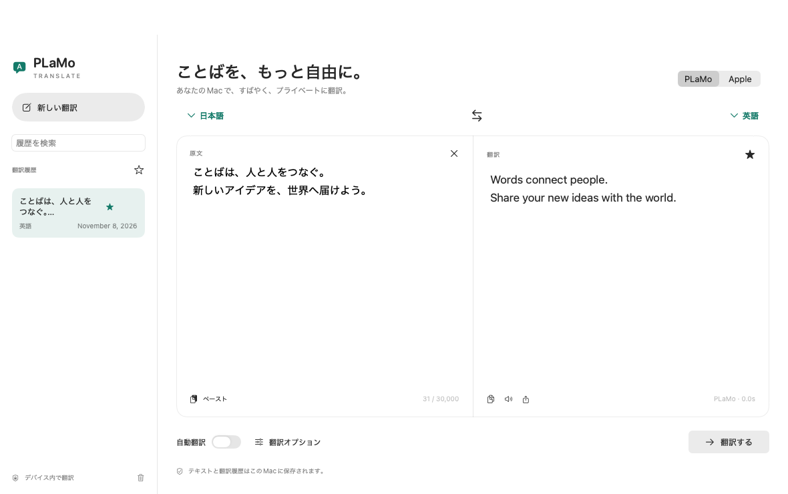

# PLaMo Translate for macOS

PLaMo 3 TranslateをMacの中で動かす、SwiftUI製の翻訳アプリです。左右の翻訳ペインと履歴サイドバーを備え、日本語・EnglishのUIに切り替えられます。

Built with PLaMo.



## 必要な環境

- macOS 15以降
- Swift 6以降（Xcode、またはCommand Line Tools）
- Apple Silicon推奨。配布スクリプトは実行するMacのarm64 / x86_64に対応します。実機検証はApple Siliconで実施しています。
- 初回のエンジン・モデル取得時にインターネット接続が必要です。PLaMoは取得後、オフラインで使えます。

## 起動

```sh
./scripts/fetch-engine.sh
swift run PlamoTranslate
```

「設定 → モデル」からモデルをダウンロードします。初回はPLaMo Community Licenseの全文を表示し、同意後に取得します。最小のおすすめモデルは **0.8B · Q4_K_M（約573 MB）** です。14種類の0.8B / 2B / 8B / 31Bモデルから選べます。各モデルのサイズとSHA-256を照合し、停止したダウンロードは再開できます。

PLaMoは翻訳時に自動で読み込まれます。llama.cppを`127.0.0.1`の一時ポートで起動し、起動ごとに作る認証トークンで接続します。推論にはMetalを使います。アプリ終了時にエンジンも終了します。

Apple翻訳も選択できます。対応言語や言語データのダウンロードはmacOSのTranslation.frameworkが管理します。参考コンテキスト・用語集・日本語の文体指定はPLaMoで利用できます。

## 機能

- 入力後の自動翻訳、ストリーミング表示、手動翻訳、停止
- 原文言語の自動検出、言語の入れ替え、コピー・読み上げ・テキスト書き出し
- ローカル翻訳履歴の検索・お気に入り・削除（通常履歴は直近100件、お気に入りは保持）
- 日英UI、システム / ライト / ダークの外観
- ウィンドウを閉じたときの「バックグラウンド / 終了 / 毎回確認」
- ログイン時の自動起動（下記の.appをApplicationsに置いて利用）
- 選択テキストの翻訳：設定で有効にし、他のアプリでテキストを選択して **⌘Cを0.5秒以内に2回** 押すと、コピーされたテキストを翻訳

ショートカットにはシステム設定のアクセシビリティ許可が必要です。許可後にアプリを再起動してください。コピーできるテキストで動作します。通常の⌘Cはそのまま使えます。

| 操作 | キー |
| --- | --- |
| 新しい翻訳 | ⌘N |
| 翻訳 | ⌘Return |
| 停止 | ⌘. |
| 言語の入れ替え | ⇧⌘S |
| 翻訳をコピー | ⇧⌘C |
| 設定 | ⌘, |
| 履歴の表示切り替え | ⌃⌘H |

## .appの作成

```sh
./scripts/build-app.sh
open 'dist/PLaMo Translate.app'
```

`dist/PLaMo Translate.app`に、実行ファイル・翻訳エンジン・dylib・ライセンス・リソースをまとめます。初期設定ではローカルのアドホック署名です。外部配布用のDeveloper ID署名・公証は別途必要です。`CODE_SIGN_IDENTITY`で署名IDを指定できます。モデル自体はアプリに同梱しません。

## 検証

```sh
./scripts/test.sh
swift build
.build/debug/PlamoTranslate --ui-smoke-test .build/ui-snapshots
```

`test.sh`はXcodeとCommand Line Toolsの両方でSwift Testingを実行します。通常テストはネットワーク接続不要です。Range応答異常、Range無視、SHA不一致、転送中断、キャンセル、PFML、ローカル保存、履歴復元、古い翻訳結果の排除を検証します。

実モデルの取得・Metal翻訳・API認証を確認する統合テストもあります。実行前に[モデルライセンス全文](Sources/PlamoTranslate/Resources/ModelLicense-ja.txt)を確認してください。

```sh
./scripts/fetch-engine.sh
PLAMO_METAL_TEST=1 PLAMO_ACCEPT_MODEL_LICENSE=1 \
  ./scripts/test.sh --filter MetalIntegrationTests
```

モデルは`.build/metal-verification`に保存され、通常の設定やライセンス同意状態には影響しません。UIスモークテストも一時ストアを使い、実ウィンドウのPNGを出力します。テキストは固定の表示確認用サンプルです。

## データとトラブルシューティング

設定、履歴、モデルは`~/Library/Application Support/PlamoTranslate/`に保存します。翻訳テキストを外部APIへ送信する機能はありません。履歴保存をオフにすると以後の翻訳を保存しません。既存履歴は履歴欄のゴミ箱から削除できます。

エンジン起動に失敗した場合は「設定 → モデル」で保存先を開き、`engine.log`を確認してください。モデルを読み込み直すには「モデルをメモリから解放」を使います。コンテキスト・出力上限に達した場合は文章を短く分けてください。入力は1回30,000文字までです。

## 参照元とライセンス

モデル管理とPFML3形式は[tanakh/plamo-translate-desktop](https://github.com/tanakh/plamo-translate-desktop)を参考にしています。推論エンジンは[llama.cpp b12110](https://github.com/ggml-org/llama.cpp/releases/tag/b12110)です。固定版のエンジンアーカイブもSHA-256を検証します。

モデルはPreferred NetworksのPLaMo Community Licenseに従います。アプリが利用する第三者コードの帰属とライセンスは[THIRD-PARTY-NOTICES.md](THIRD-PARTY-NOTICES.md)およびアプリの「設定 → このアプリについて」で確認できます。
